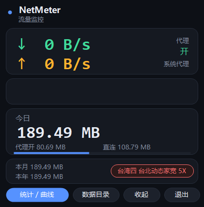

# NetMeter · Windows 流量监控

一个**单文件、零依赖**的 Windows 托盘流量监控小工具。编译出来只有 **50 KB**，不装运行库、不联网、不写注册表（除了可选的「开机自启」）。

主要是为了解决一个具体问题：**机场/代理订阅的流量跑得比预期快很多**，而 Windows 自带的「数据使用量」既分不清「走代理」和「直连」，也不告诉你当前节点是几倍计费。



---

## 为什么做这个

排查订阅流量异常时遇到的问题：

1. Windows 的「数据使用量」只按程序统计，**分不出哪些流量走了代理**；
2. 机场的节点名字里写着 `5X`、`3X`、`1x`——这是**流量倍率**，用 1 GB 可能扣 5 GB，但系统层面完全看不到；
3. 想按天回溯"到底哪天用了多少"，系统只保留 30 天汇总，且不分类。

所以这个工具自己维护一份按天的账本，并把代理/直连分开记。

---

## 功能

### 主界面

| 区域 | 内容 |
|---|---|
| 实时速率 | 当前下行 / 上行（每秒刷新） |
| 3 分钟曲线 | 最近 180 秒的下行（绿）/ 上行（橙）走势 |
| 今日 | 今日合计，并拆成「代理开」和「直连」两笔，带占比条 |
| 底部 | 本月 / 本年累计；右侧圆角徽章显示当前 Clash 节点名与倍率 |

节点倍率 ≥ 3 时，徽章变红提醒（`台湾四 台北动态家宽 5X` 这类）。

### 统计窗口

- **历史**：按天列出「合计 / 代理开 / 直连」，滚轮翻页
- **曲线**：大尺寸渐变曲线 + 今日每小时柱状图
- **程序**：按程序统计下载/上传/合计（需要管理员，见下）
- **说明**：数据口径说明

### 其他

- **关掉再开不会清零**：今日数据每 5 秒写盘，跨天自动结转
- **开机自启**：计划任务（登录触发）
- **崩溃自动拉起**：每 5 分钟看护一次，进程没了就重新启动
- **托盘常驻**：双击图标打开窗口，关窗口只缩到托盘，统计不中断
- **轻量**：常驻内存 20~50 MB，每秒采样一次

---

## 快速开始

### 方式一：直接编译

需要 **Windows 10/11**，系统自带 .NET Framework 4.x（几乎所有机器都有）。

```powershell
powershell -ExecutionPolicy Bypass -File build.ps1
```

编译出 `NetMeter.exe`，双击运行即可，程序会出现在右下角托盘（深色圆底 + 绿色↓橙色↑ 图标）。

### 方式二：自己用 csc 编译

```powershell
& "$env:WINDIR\Microsoft.NET\Framework64\v4.0.30319\csc.exe" `
  /target:winexe /optimize+ /out:NetMeter.exe `
  /r:System.Windows.Forms.dll /r:System.Drawing.dll src\NetMeter.cs
```

---

## 按程序统计（可选）

「程序」页默认是空的，会提示需要管理员权限。

原因：Windows 的 **TCP 扩展统计**（`GetPerTcpConnectionEStats`）只允许管理员读取，普通权限调用直接返回 `ERROR_ACCESS_DENIED`。

打开「统计」→「程序」→ 点 **以管理员身份重启** → UAC 点「是」。之后：

- 程序以管理员身份运行，「程序」页按用量排出每个进程；
- 同时会把两个计划任务重建为**最高权限**，以后开机自启不再弹 UAC。

### 这一页的局限

- 只统计 **TCP 已建立连接**，极短命的连接（秒级）可能记不全；
- **UDP 不计**（QUIC、部分游戏和语音走 UDP，这部分只体现在总量里）；
- IPv6 连接暂未单独统计；
- 连接断开后不再更新。

所以：**总量看主界面，谁是主要消耗者看「程序」页**，两者会有差距，属正常。

---

## 数据在哪

```
%APPDATA%\NetMeter\
├── history.csv     每日合计（date,rx,tx,proxy_rx,proxy_tx）
├── state.ini       今日累计 + 每小时分布
├── apps.csv        按程序（需管理员）
├── traffic.csv     每 5 分钟快照，便于画图
├── events.log      代理开关切换记录
└── perapp.log      按程序统计的诊断日志
```

`history.csv` 是纯文本，可以直接用 Excel 打开做透视。

想清空重来：退出程序 → 删掉这个目录 → 重新启动。

---

## 分钟级的口径说明

- **只统计物理网卡**：通过 `iphlpapi!GetIfTable2` 取每块网卡的累计字节，并把 `NetworkInterface` 里不存在的"过滤器驱动重复行"（WFP / Npcap / QoS 会为同一块网卡列出 7 份）过滤掉，否则会多算约 12 倍。
- **排除虚拟网卡**：TUN（Mihomo）、Wi-Fi Direct、蓝牙、VMware/VirtualBox、Teredo 等不计入，避免同一份流量算两次。
- **代理判定**：系统代理（`ProxyEnable=1` 且 `ProxyServer` 非空）或 TUN 网卡在线，即认为"代理开"。
- **计费估算**：今日代理流量 × 当前节点倍率。**中途换过节点会不准**，仅供参考。

---

## 卸载

1. 托盘右键 → 退出；
2. 删除两个计划任务：

```powershell
schtasks /delete /tn NetMeter /f
schtasks /delete /tn NetMeterWatch /f
```

3. 删掉 `%LOCALAPPDATA%\NetMeter\` 和 `%APPDATA%\NetMeter\`；
4. 如果勾过「自启」，删除注册表 `HKCU\Software\Microsoft\Windows\CurrentVersion\Run` 下的 `NetMeter`。

---

## 已知问题

- 窗口是**无边框自绘**的，在高 DPI 缩放下可能偏小（未做 DPI 感知）；
- 按程序统计受限于 TCP 扩展统计，见上文；
- 只支持 Windows。

---

## License

[MIT](LICENSE)
