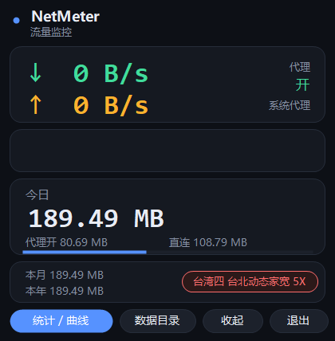

# NetMeter · Windows Traffic Monitor

A **single-file, zero-dependency** Windows tray traffic monitor. The compiled binary is about **50 KB** — no runtime installs, no network calls, no registry writes (except the optional "start with Windows").

It exists to answer one question: **why is my proxy subscription quota draining so fast?**
Windows' built-in Data Usage splits traffic per app, but it cannot tell you which bytes went through the proxy, nor that a node named `5X` charges **5× the traffic** you actually use.



---

## Features

**Main window**

| Area | What it shows |
|---|---|
| Live speed | Current down / up, refreshed every second |
| Sparkline | Last 180 seconds of down (green) / up (orange) |
| Today | Total for today, split into "proxy on" and "direct", with a share bar |
| Footer | Month / year totals; a pill on the right shows the current Clash node and its multiplier |

When the node multiplier is ≥ 3 the pill turns red (`5X` dynamic-home-broadband nodes are common culprits).

**Statistics window**

- **History** — daily table: total / proxy / direct, mouse-wheel paging
- **Chart** — large gradient sparkline plus an hourly bar chart for today
- **Apps** — per-process down / up / total (requires administrator, see below)
- **Notes** — how the numbers are measured

**Also**

- **Survives restarts** — today's counters flush to disk every 5 seconds; days roll over automatically
- **Start with Windows** — via a scheduled task (logon trigger)
- **Auto-restart** — a watchdog task re-launches it within 5 minutes if the process dies
- **Tray resident** — closing the window just hides it; sampling continues
- **Lightweight** — 20–50 MB resident, one sample per second

---

## Quick start

Requires **Windows 10/11** with the bundled .NET Framework 4.x.

```powershell
powershell -ExecutionPolicy Bypass -File build.ps1
```

Run the produced `NetMeter.exe`; it appears in the tray (dark round icon with green↓ / orange↑ arrows).

Manual build:

```powershell
& "$env:WINDIR\Microsoft.NET\Framework64\v4.0.30319\csc.exe" `
  /target:winexe /optimize+ /out:NetMeter.exe `
  /r:System.Windows.Forms.dll /r:System.Drawing.dll src\NetMeter.cs
```

---

## Per-app statistics (optional)

The **Apps** tab is empty by default and explains that administrator rights are required.

Windows only exposes per-connection byte counters through **TCP extended statistics** (`GetPerTcpConnectionEStats`), and only to elevated callers — a normal process gets `ERROR_ACCESS_DENIED`.

Click **Restart as administrator** on that tab and accept the UAC prompt. After that the tabs populate, and the two scheduled tasks are recreated with `HighestAvailable` so future auto-starts do not prompt again.

Limitations of that tab:

- Only **ESTABLISHED TCP connections** are sampled; very short-lived connections may be missed
- **UDP is not counted** (QUIC, some games and voice chat)
- IPv6 is not tracked separately
- Closed connections stop updating

So: use the main window for totals, the Apps tab to see *who* is consuming.

---

## Where the data lives

```
%APPDATA%\NetMeter\
├── history.csv     daily totals (date,rx,tx,proxy_rx,proxy_tx)
├── state.ini       today's counters + hourly distribution
├── apps.csv        per-app counters (admin only)
├── traffic.csv     snapshot every 5 minutes
├── events.log      proxy on/off transitions
└── perapp.log      diagnostics for per-app sampling
```

`history.csv` is plain text — open it in Excel.

---

## How the numbers are measured

- **Physical adapters only.** Byte counters come from `iphlpapi!GetIfTable2`, and rows that do not correspond to a real `NetworkInterface` are dropped — filter drivers (WFP / Npcap / QoS) each report the same adapter seven times, which inflates totals ~12×.
- **Virtual adapters excluded.** TUN (Mihomo), Wi-Fi Direct, Bluetooth, VMware/VirtualBox, Teredo and similar are skipped so traffic is not double counted.
- **Proxy detection.** System proxy enabled (`ProxyEnable=1` with a non-empty `ProxyServer`) or a live TUN adapter counts as "proxy on".
- **Billing estimate.** Today's proxy traffic × the current node multiplier. Switching nodes mid-day makes this wrong — treat it as a hint.

---

## Uninstall

```powershell
schtasks /delete /tn NetMeter /f
schtasks /delete /tn NetMeterWatch /f
```

Then delete `%LOCALAPPDATA%\NetMeter\` and `%APPDATA%\NetMeter\`, and remove the `NetMeter` value under `HKCU\Software\Microsoft\Windows\CurrentVersion\Run` if you enabled autostart.

---

## Known issues

- Borderless, fully custom-drawn window; no DPI awareness, so it may look small on scaled displays
- Per-app stats are constrained by TCP extended statistics (see above)
- Windows only

---

## License

[MIT](LICENSE)
